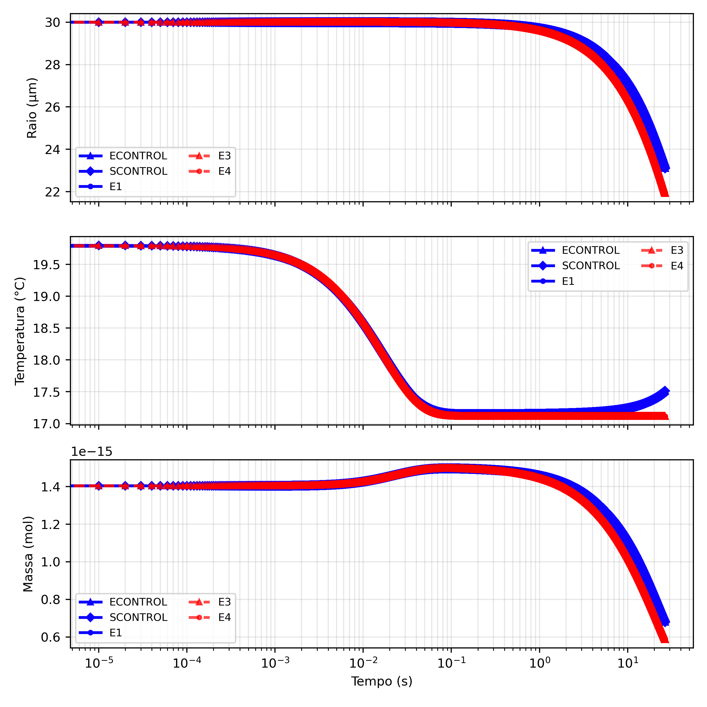
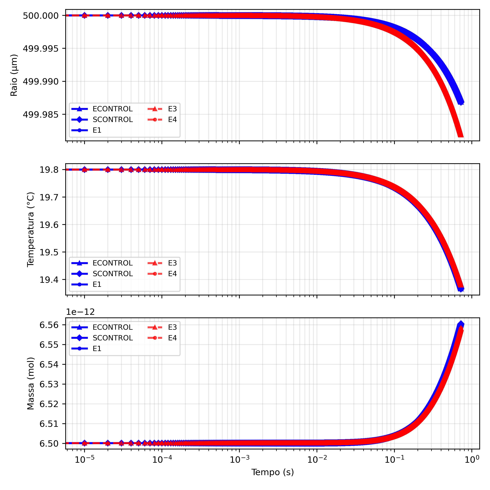
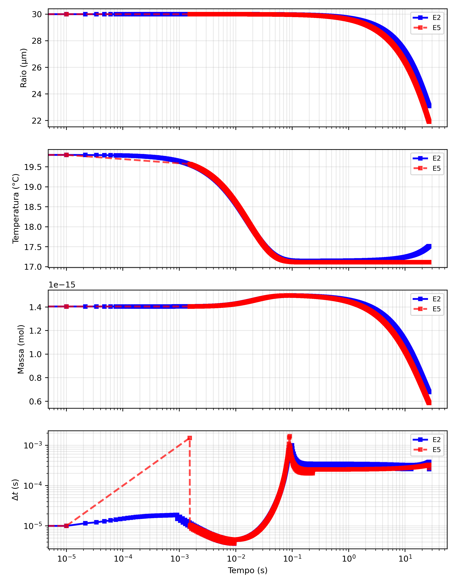
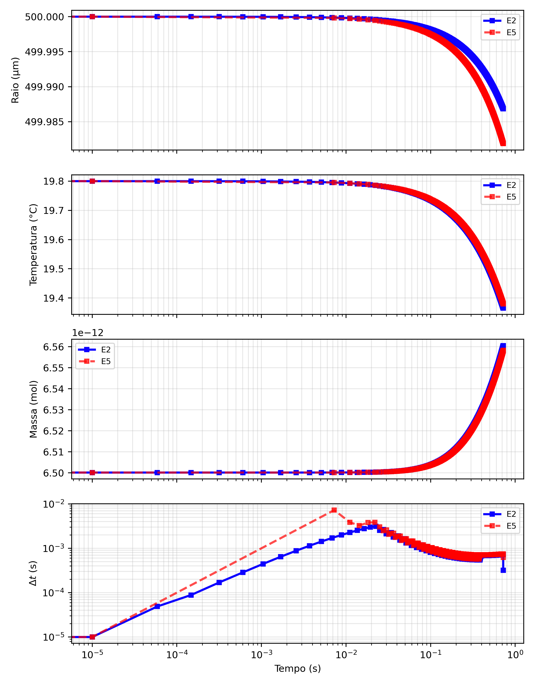

# TCC: Avaliação de Simplificações do Modelo Físico e de Métodos de Integração Temporal Aplicados à Difusão de Gás em Gotículas Marinha

Trabalho de Conclusão de Curso · Bacharelado em Matemática Industrial · UFES (CEUNES) · 2026 · Orientador: Prof. Dr. Iury Angelo Gonçalves · Aluno: Emanuel Pinto Sampaio

Texto do TCC: [PDF](relatorio/Emanuel_relatório_final_TCC.pdf) · Iniciações científicas: [IC1](https://github.com/emanuelpintosampaio/IC1) · [IC2](https://github.com/emanuelpintosampaio/IC2)

## Resumo

Simulação da absorção de CO₂ por gotículas de espuma marinha comparando duas formas de modelar o problema: o **sistema completo** de equações para o raio, a temperatura e a massa, e um **modelo simplificado**, em que raio e temperatura seguem decaimentos exponenciais. Os dois são resolvidos pelo **método de Euler Explícito** com três estratégias de passo de tempo (fixo, subpassos e adaptativo com controle PID) e comparados com uma solução de referência, o SCONTROL (sistema completo resolvido por SSPRK3 com passo fixo). Gotículas de 30 e 500 µm.

| Modelo | Passo fixo | Subpassos | PID |
|---|---|---|---|
| Sistema completo | ECONTROL | E1 | E2 |
| Simplificado | E3 | E4 | E5 |

## Rodar no Google Colab

Abra um notebook em [colab.research.google.com](https://colab.research.google.com/), cole numa célula e execute:

```python
%cd /content
![ -d TCC ] || git clone -q https://github.com/emanuelpintosampaio/TCC.git
%cd TCC/codigos
%run menu_colab.py
```

O menu pede o raio da gota (30 ou 500 µm) e o experimento (ou todos juntos) e mostra os gráficos.

## Resultados

Passo fixo e subpassos:

| 30 µm | 500 µm |
|---|---|
|  |  |

Passo adaptativo com controle PID:

| 30 µm | 500 µm |
|---|---|
|  |  |

Erro relativo final em relação ao SCONTROL:

| Experimento | 30 µm | 500 µm |
|---|---|---|
| ECONTROL | 4,94 × 10⁻⁷ | 1,23 × 10⁻⁷ |
| E1 | 5,08 × 10⁻⁶ | 1,41 × 10⁻⁵ |
| E2 | 1,69 × 10⁻⁵ | 9,06 × 10⁻⁶ |
| E3 | 1,36 × 10⁻¹ | 3,43 × 10⁻⁴ |
| E4 | 1,36 × 10⁻¹ | 3,29 × 10⁻⁴ |
| E5 | 1,36 × 10⁻¹ | 3,45 × 10⁻⁴ |

## Conclusão

O erro do Euler Explícito no sistema completo é desprezível nos dois tamanhos de gota. O erro da simplificação exponencial é muito maior (13,6% para 30 µm) e compromete a solução para gotas pequenas; ela só é segura para gotas grandes e, mesmo assim, economiza pouco tempo. Ou seja, a perda de acurácia vem da simplificação da física, e não do integrador mais simples. O Euler Explícito é mais barato que o SSPRK3 (uma avaliação do sistema por passo, contra três), e o controle adaptativo PID foi a estratégia de passo mais econômica. **O experimento recomendado é o E2** (Euler Explícito no sistema completo com passo adaptativo PID): mantém a acurácia do modelo completo e foi o mais rápido de todos, sem precisar simplificar a física.

## Errata

Na abertura do Capítulo 3 (página 48), o texto diz que o SCONTROL usa passo fixo Δt = 10⁻³ s. O passo usado nos resultados é **Δt = 10⁻⁴ s**, como está na Seção 3.3 e nos scripts `SCONTROL_30.py` e `SCONTROL_500.py`.

## Arquivos

- `codigos/`: um script por experimento e raio (`SCONTROL`, `ECONTROL` e `E1` a `E5`, com final `_30` ou `_500`), `all_30.py` e `all_500.py` (todos juntos), `Figura5.py` (modelo completo × simplificado) e os módulos físicos.
- `figuras_relatorio/`: gráficos do texto, capturas dos tempos de execução (`Tabela_3.png` para 30 µm e `Tabela_4.png` para 500 µm) e `Motivo_Figura_6.png` (teste com Δt = 10⁻³ s, em que E1 e E4 divergem).
- `relatorio/`: texto do TCC em PDF.
